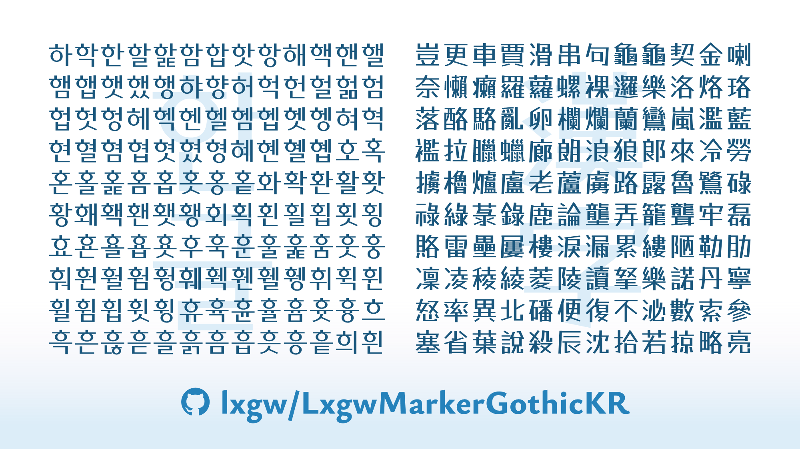

[English](./README.md) | [한국어](./README-KR.md) | 繁體中文 
# 霞鶩漫黑 KR / LXGW Marker Gothic KR / LXGW 마커고딕 KR
[霞鶩漫黑](https://github.com/lxgw/LxgwMarkerGothic)韓文版。

## 字體簡介
「霞鶩漫黑 KR」是一款基於馬克筆 POP 字型 [Tanugo](https://tanukifont.com/tanugo/) 衍生的開源字型。Tanugo 由 たぬき侍 最初設計。

「霞鶩漫黑 KR」爲韓文排版而製作，包含了常用諺文音節，以及一些漢字。

### 包含字符
- KS X 1001 收錄的所有諺文音節，共 2,350 個；
- KS X 1001 收錄的所有漢字，共 4,620 個；
- 「霞鶩漫黑」所包含的大部分拉丁字符、標點符號和特殊符號。
## 獲取字體
直接下載
在 [Releases](https://github.com/lxgw/LxgwWenkaiTC/releases) 介面下載 ttf 格式字型檔，或在本倉庫 [fonts/TTF](./fonts/TTF) 資料夾中下載預編譯的字型檔。 
## 授權協議
本字型依據 [SIL Open Font License 1.1](https://openfontlicense.org) 授權協議條款發行。
### 許可
- 這款字型無論是個人還是企業都可以自由商用，無需付費，也無需知會或者標明原作者。 *（但如果告知，我會很感激。）*
- 這款字型可以自由傳播、分享，或者將字型安裝於軟硬體也是允許的，可以與任何軟體捆綁再分發以及／或一併銷售。
- 這款字型可以自由修改、改造，製作衍生字型。修改或改造後的字型也必須同樣以 [SIL OFL](https://openfontlicense.org) 公開。
### 限制
- 根據 [SIL Open Font License 1.1](https://openfontlicense.org) 「許可與條件」中第 1 條的規定， **禁止單獨出售字型檔(OTF/TTF檔)的行爲。**
- 該字型不可在 [SIL Open Font License 1.1](https://openfontlicense.org) 以外的授權許可下發行。
- 未經作者 @lxgw 書面授權，衍生字型名稱中不得包含保留名稱「LXGW」「霞鶩」。
## 作者
- 原始字型設計師：たぬき侍（Tanukizamurai）
- 衍生字型開發者：LXGW 霞鶩
## 更多開源韓文字型
- [霞鶩文楷 KR](https://github.com/lxgw/LxgwWenKaiKR)
