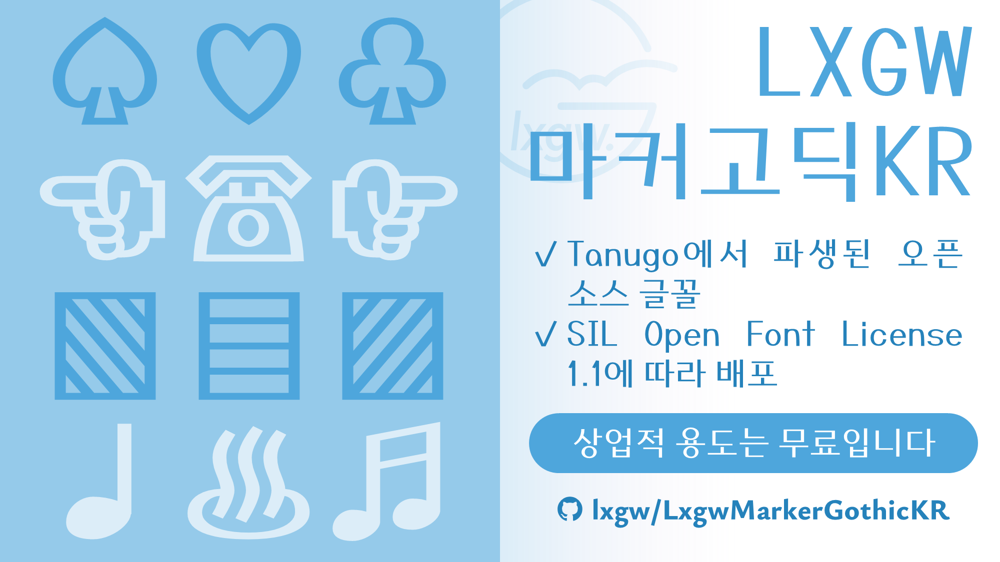
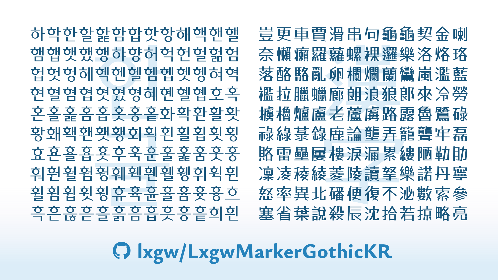

[English](./README.md) | 한국어 | [繁體中文](./README-CHT.md) 
# LXGW 마커고딕 KR / LXGW Marker Gothic KR / 霞鶩漫黑 KR
[LXGW Marker Gothic](https://github.com/lxgw/LxgwMarkerGothic)의 한글판.
## 소개
LXGW 마커고딕 KR은 마커 펜으로 손으로 쓴 POP 글꼴로, 타누키자무라이가 처음 디자인한 [Tanugo](https://tanukifont.com/tanugo/)에서 파생된 오픈 소스 글꼴입니다. 이 글꼴은 한글 타이포그래피용으로 제작되었으며, 자주 사용되는 한글 음절과 몇 가지 한자 세트가 포함되어 있습니다.

### 문자
- KS X 1001의 모든 현대 한글 음절(2,350자);
- KS X 1001의 모든 한자(4,620자);
- LXGW Marker Gothic의 대부분의 라틴 문자, 구두점 및 기호.
## 글꼴 가져오기
### 글꼴 파일 다운로드
최신 출시 글꼴은 [릴리즈](https://github.com/lxgw/LxgwWenKaiKR/releases) 페이지에서 다운로드할 수 있습니다. 미리 빌드된 폰트 파일은 [fonts/TTF](./fonts/TTF) 폴더에서 다운로드할 수도 있습니다.
## 라이선스
이 글꼴은 [SIL Open Font License 1.1](https://openfontlicense.org)에 따라 배포됩니다.
### 권한
라이선스에 따라 이 글꼴을 상업적 용도로도 자유롭게 사용, 삽입, 수정 및 재배포할 수 있습니다.
### 제한 사항 
- 이 글꼴 자체를 판매할 수 없습니다.
- 이 글꼴은 SIL OFL 1.1을 제외한 라이선스에 따라 재배포할 수 없습니다.
- 작성자(@lxgw)의 서면 허가 없이, 예약된 이름 'LXGW'는 파생 글꼴의 이름에 포함될 수 없습니다.
## 저자
- 오리지널 디자이너: 타누키자무라이(Tanukizamurai)
- 파생 개발자: LXGW 
## 더 많은 오픈소스 한국어 글꼴
- [LXGW 문해 KR](https://github.com/lxgw/LxgwWenKaiKR)
