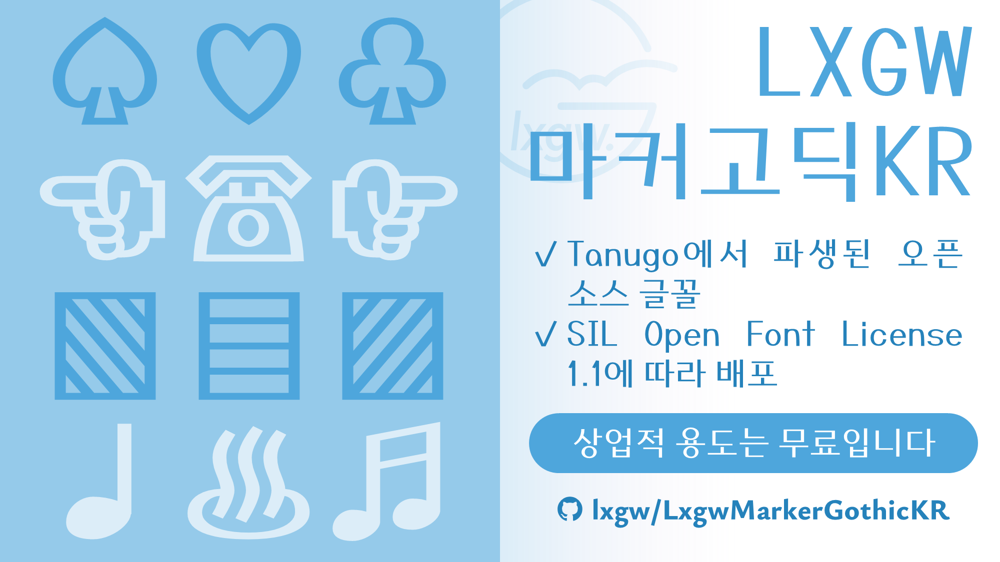
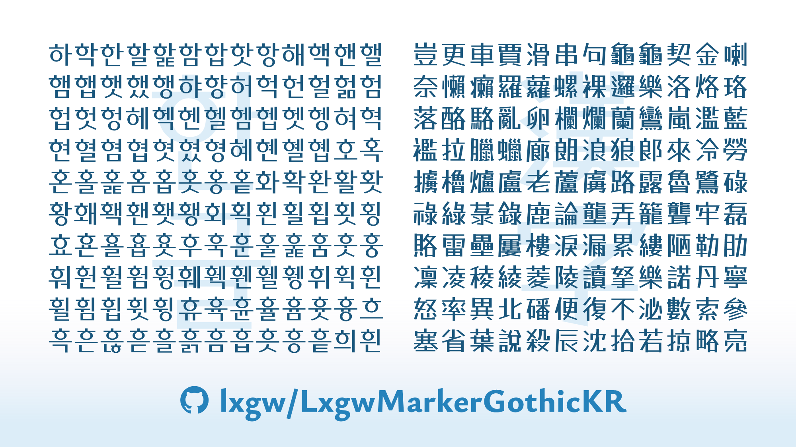

English | [한국어](./README-KR.md) | [繁體中文](./README-CHT.md) 
# LXGW Marker Gothic KR / LXGW 마커고딕 KR / 霞鶩漫黑 KR
The Korean Edition of [LXGW Marker Gothic](https://github.com/lxgw/LxgwMarkerGothic).
## Introduction
LXGW Marker Gothic KR is an open-source font derived from [Tanugo](https://tanukifont.com/tanugo/), a POP font handwritten by marker pen and originally designed by Tanukizamurai. This font is made for Korean typography and contains a set of common used Hangul syllables and a few Hanjas.

### Characters
- All modern Hangul syllables in KS X 1001 (2,350 characters);
- All Hanjas in KS X 1001 (4,620 characters);
- Most of Latin characters, punctuations and symbols in LXGW Marker Gothic.
## Get the font
### Download the font files
You can download the latest released fonts in [Releases](https://github.com/lxgw/LxgwMarkerGothicKR/releases) page. You can also download the pre-built font files in [fonts/TTF](./fonts/TTF) folder.
## License
This font is distributed under [SIL Open Font License 1.1](https://openfontlicense.org).
### Permissions
According to the license, you can use, embed, modify and redistribute this font freely and free of charge, even commercial uses.
### Restrictions 
- You cannot sell this font itself.
- You cannot redistribute this font under the license except SIL OFL 1.1.
- Without written authorization from the author (@lxgw), the Reserved Name “LXGW” may not be included in the names of Derivative Fonts.
## Authors
- Original designer: Tanukizamurai
- Derivative developer: LXGW
## More open-source Korean fonts
- [LXGW WenKai KR](https://github.com/lxgw/LxgwWenKaiKR)
